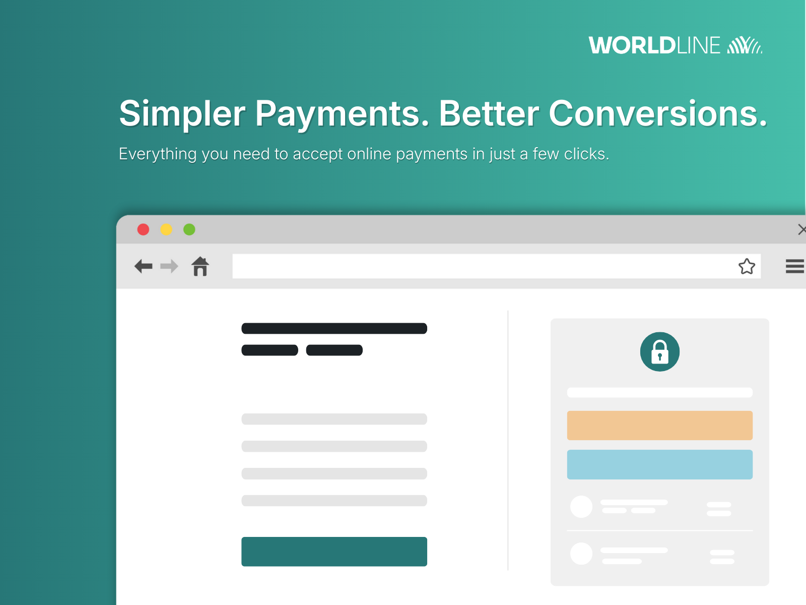
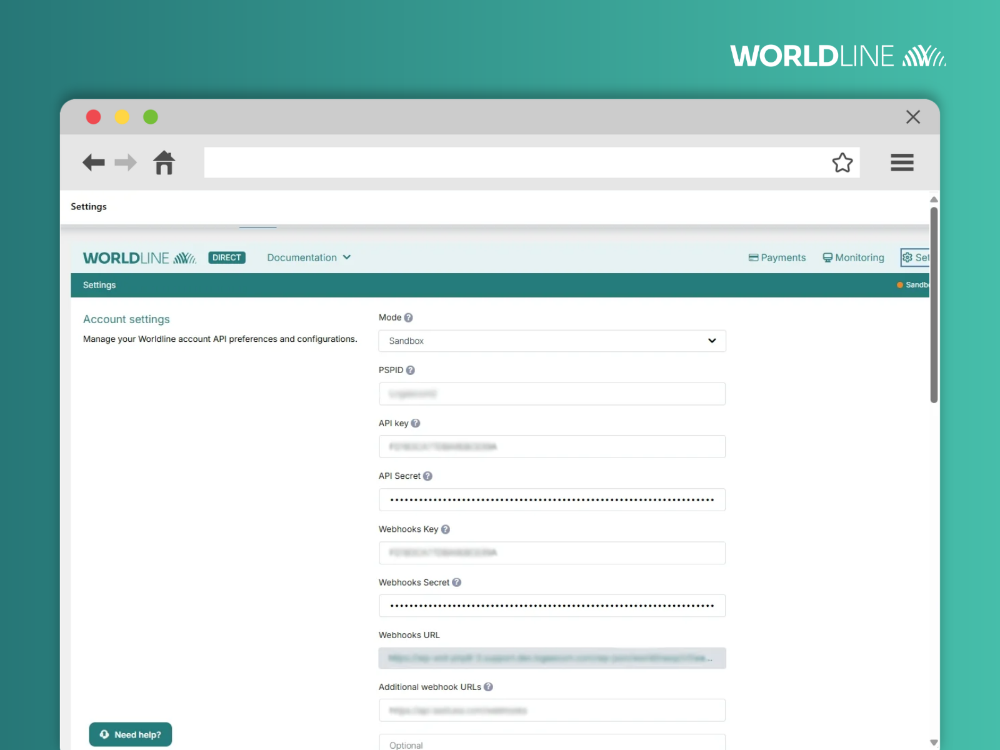

# Worldline GoPay for WooCommerce

## Description

### Worldline GoPay for WooCommerce

Accept credit/debit cards, digital wallets, and over a dozen local payment methods with a fast, secure checkout that boosts conversions and builds customer trust.

* Quick and frictionless checkout experience
* Customisable checkout pages
* Support for the most popular global payment methods (Visa, MasterCard, Google Pay, Apple Pay, American Express, PayPal, Klarna, etc.)
* 15+ local payment methods supported (iDEAL, Carte Bancaire, Bizum, Bancontact, etc.)
* Authorisation and Direct Sale modes for transactions
* Cancellations, captures and refunds management
* Seamless exemption management
* PSD2 and PCI-DSS compliant
* Localised payment experience in 100+ countries
* Multistore support
* No-code setup

### Optimise your payment pages and boost conversion rates by up to 35%

Customise the design of your checkout page and give shoppers the payment options they know and trust. Activate popular local payment methods and create a more familiar checkout experience for international customers. A personalised checkout experience reduces cart abandonment rates and maximises conversion rates in every market you sell in.

### Features

#### Faster checkout

Use Worldline’s plugin to easily implement a checkout page on your store while avoiding the most common checkout errors. Let your customers either pay directly on your store with an embedded checkout page ([Hosted Tokenization Page](https://docs.direct.worldline-solutions.com/en/integration/basic-integration-methods/hosted-tokenization-page)) or get redirected to a secure Worldline page ([Hosted Checkout Page](https://docs.direct.worldline-solutions.com/en/integration/basic-integration-methods/hosted-checkout-page)) while keeping your shop PCI-compliant.

#### Customisable checkout pages

Make your checkout feel like a natural extension of your brand. This plugin offers customisable checkout templates, allowing you to match your store’s design, colours, and tone.

Whether you want a minimalist payment form or a fully branded checkout, the plugin gives you flexible options to reinforce trust and keep shoppers engaged.

#### Global payments

Let your customers pay how they want — with credit card, digital wallet, bank transfer, mealvouchers, and more. Worldline’s WooCommerce plugin supports over 25 global and local payment methods across more than 100 countries and 150 currencies.

You can enable or disable methods individually, set your preferred payment gateway titles, and fine-tune the checkout button text — all from your WooCommerce dashboard.

#### Multistore support

Selling across multiple stores or regions? This plugin is fully compatible with WooCommerce multistore setups, including multisite installations.

Each store in your network can have its own independent payment configuration, including API keys, payment methods, currencies, and checkout behaviours. This gives you complete control when managing localised stores, marketplace-style setups, or international storefronts.

### Supported Payment Methods and Currencies

Worldline GoPay plugin supports over 25 global and local payment methods, including:

* Credit and debit cards (Mastercard, Visa, American Express, Cartes Bancaires, etc.)
* Bank transfers
* Digital wallets (Apple Pay, Google Pay, PayPal, etc.)
* Buy now, pay later providers (e.g., Klarna)
* Local payment methods (EPS, iDEAL, Bancontact, P24, Twint, etc.)
* Mealvouchers

You can accept payments in 150+ currencies and serve customers in 100+ countries, ensuring a localised and conversion-friendly experience for every buyer — no matter where they are.

### Add Worldline GoPay payments to your WooCommerce store today

Choose the secure, reliable, and future-ready payments solution designed to support your store at every stage of growth. Install the Worldline GoPay WooCommerce plugin in just a few clicks and start accepting payments across 100+ countries immediately.

### About Worldline GoPay

Worldline GoPay is a leading global payments company with a unique mission: to turn payments from a simple necessity into a strategic advantage. As Europe’s leading payment service provider and ranked among the top worldwide, we power secure, frictionless online payment experiences.

We combine scale (over 18,000 professionals operating in 40+ countries), cutting-edge payment technology and deep industry expertise to support more than 1.4 million businesses across 170+ markets. Whether you are a small shop or a large marketplace, our solutions are designed to fit your needs — helping you grow quickly, simply, and securely.

## Screenshots

## Installation

### Requirements

To install and configure the Worldline GoPay for WooCommerce plugin, you’ll need:

* WordPress Version 6.3 (or newer) installed.
* An active WooCommerce store version 8.7 (or newer).
* PHP version 7.4 or newer.
* Worldline Merchant Account

### Installation steps

1. Log in to your WordPress Admin panel.
2. Navigate to **Plugins > Add New**.
3. Search for the “**Worldline GoPay for WooCommerce**” plugin.
4. Click on Install Now and wait until the installation finishes.
5. Click the Activate button on the success page (or activate it later in **Plugins > Installed Plugins**).

### Configuration

#### Connection

1. After activating the Worldline GoPay for WooCommerce plugin, navigate to **WooCommerce > Settings > Payments**.
2. Click “**Manage**” on Worldline GoPay for WooCommerce.
3. Fill in the PSPID, API Key, and API Secret fields (live/test depending on your environment) from your Worldline Merchant Portal (Developer > Payment API).

#### Webhooks

1. Navigate to **Developer > Webhooks** inside Worldline Merchant Portal and click “**Generate webhook keys**”.
2. Copy the generated details into the fields “Webhook ID” and “Webhook Secret” inside the plugin.
3. The URL(s) listed below will be used for transactions from this store, and any webhook URL(s) configured in the merchant portal will be ignored. You can add up to 4 additional webhook URLs in “Additional Webhook URLs”.

After filling connection and webhook configuration fields,  Click on “**Save changes**” to store these settings in the plugin.
For more information on configuring the Worldline GoPay for WooCommerce plugin, check out our [official onboarding guide](https://docs.direct.worldline-solutions.com/en/integration/how-to-integrate/plugins/woocommerce).

### Updating

The Worldline GoPay for WooCommerce plugin can be updated both manually and automatically. However, we still recommend backing up your site regularly, just in case.

If you encounter any issues with the plugin or its functions after an update, purge your website cache.

If that doesn’t solve the problem, create a thread on the [support forums](https://wordpress.org/support/plugin/worldline-for-woocommerce/) or contact our support team through [this form](https://docs.direct.worldline-solutions.com/en/about/contact/).

## Changelog

### 3.0.0 - 2026-11-18
* Initial version of the WooCommerce plugin on the Core architecture
